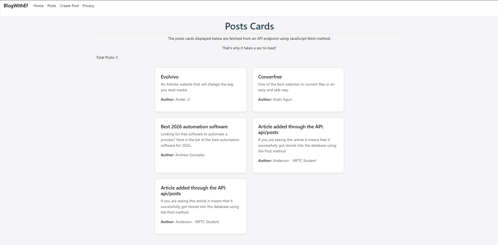

# BlogWithEf2.0

## Overview

BlogWithEf2.0 is an ASP.NET Core MVC application for creating and viewing blog posts, using Entity Framework Core with SQLite for data persistence. It also exposes a JSON API for posts and a Home page that fetches data from that API dynamically using JavaScript.

## Features

- Create new blog posts (title, body, author) via a web form.
- View all posts on the Index page.
- View a single post's details.
- JSON API (`/api/posts`) to retrieve and create posts programmatically.
- Dashboard page that fetches post data via `fetch()` and displays the total post count without a page reload.
- Data persisted using Entity Framework Core and SQLite.

## API Endpoints

| Method | Route         | Description                          |
|--------|---------------|--------------------------------------|
| GET    | `/api/posts`  | Returns all posts as JSON.           |
| POST   | `/api/posts`  | Creates a new post (validates input).|

## Implementation

- `Models/Post.cs` defines the post model.
- `Data/BlogDbContext.cs` defines the EF Core database context and `Posts` table.
- `Controllers/PostsController.cs` handles the web UI (Index, Details, Create views).
- `Controllers/PostsApiController.cs` handles the JSON API (`GET`/`POST /api/posts`).
- `Views/Home/Index.cshtml` fetches `/api/posts` client-side and displays the live post count.

## How to Run

1. Clone the repository.
2. Navigate to the project folder: `cd BlogWithEf2.0`
3. Restore dependencies: `dotnet restore`
4. Apply database migrations: `dotnet ef database update`
5. Run the application: `dotnet run`
6. Navigate to `/Posts` to view/create posts, or `/` to see the live post count.

## Screenshots

## Technologies

- C#
- ASP.NET Core MVC
- Entity Framework Core
- SQLite
- JavaScript (`fetch`)
- Dependency Injection
- Git and GitHub